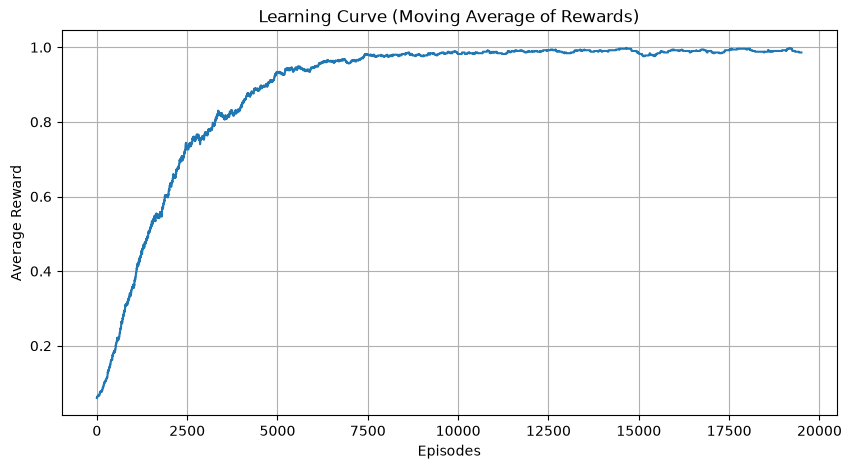
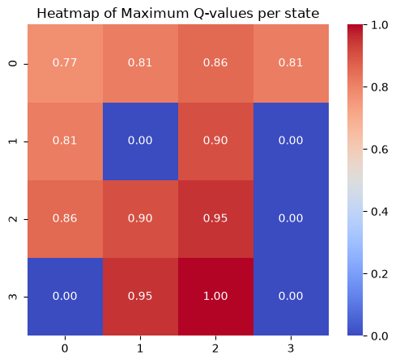
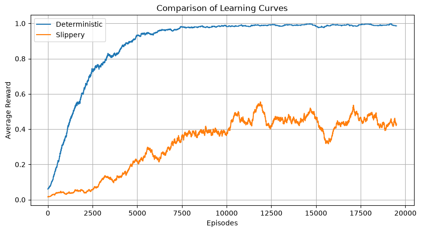
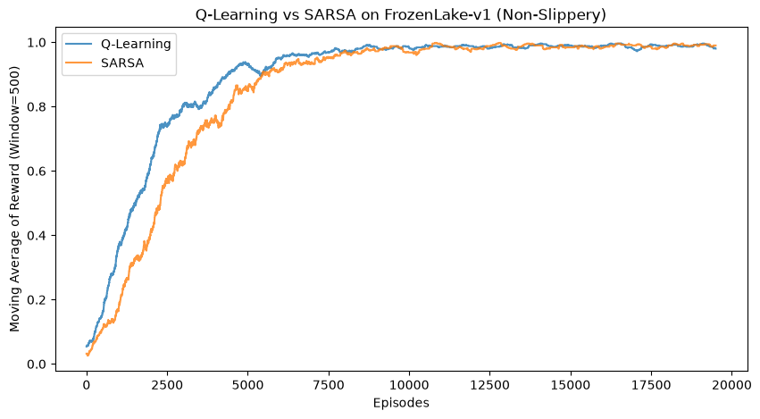
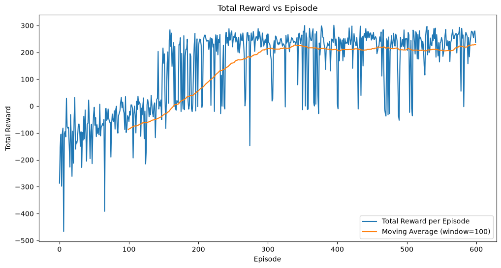
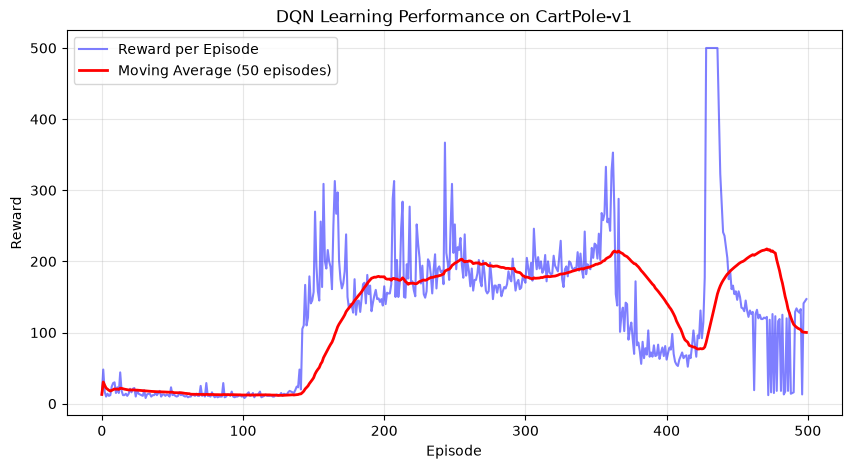

# Assignment 1 — Reinforcement Learning Laboratory

**Advanced Statistical Learning and Modeling · Module A**  
**Student:** Omid Shojaeian  
**Report based on:** the four fully executed Assignment 1 notebooks on GitHub, 12 October 2026.  
**Source:** official *Assignment 1: Reinforcement Learning Laboratory*, October 2025, pp. 1–4.

## Abstract

This assignment implements and evaluates tabular Q-Learning and SARSA in FrozenLake-v1, a Deep Q-Network (DQN) in LunarLander-v3, and a transfer exercise applying DQN to CartPole-v1. The experiments include learning curves, a Q-value heatmap, exploration schedules, policy comparisons and independent greedy evaluations. The observed success rates and returns are reproduced from the saved outputs of the final executed notebooks; they are not invented or inferred from an example run.

| Exercise | Environment | Final measured result |
|---|---|---|
| Q-Learning | FrozenLake-v1 (deterministic) | Greedy success **{{q_det_pct}}%** over 500 evaluation episodes |
| Q-Learning | FrozenLake-v1 (slippery) | Greedy success **{{q_slip_pct}}%** over 500 evaluation episodes |
| SARSA | FrozenLake-v1 (deterministic) | Greedy success **{{sarsa_eval_pct}}%** over 300 evaluation episodes |
| DQN | LunarLander-v3 | Greedy return **{{dqn_mean}} ± {{dqn_sd}}** (mean ± SD; 100 episodes) |
| Bonus DQN | CartPole-v1 | Greedy return **{{bonus_mean}} ± {{bonus_sd}}** (100 episodes); **not solved** by the 475 criterion |

## 1. Tabular Q-Learning on FrozenLake-v1

### T1. Implementation and parameters

The environment has 16 discrete states and four actions (left, down, right, up). The agent initializes a 16 × 4 zero-valued Q-table and uses epsilon-greedy exploration: select a random action with probability epsilon and otherwise choose an action with maximal Q-value. Training was executed twice, with **is_slippery=False** and **is_slippery=True**.

| Hyperparameter | Implemented value | Purpose |
|---|---:|---|
| Learning rate α | 0.8 | Size of each value update |
| Discount factor γ | 0.95 | Relative importance of future rewards |
| Episodes | 20,000 | Repeated interaction with the environment |
| Maximum steps per episode | 100 | Episode length cap |
| Initial epsilon | 1.00 | Initial exploration |
| Minimum epsilon | 0.01 | Residual exploration |
| Exponential decay rate | 0.0005 | Gradual transition toward exploitation |

### T2. TD target and epsilon decay

The off-policy Q-Learning rule is

**Q(s,a) ← Q(s,a) + α [r + γ max Q(s′,a′) − Q(s,a)].**

The bracketed quantity is the temporal-difference (TD) error. The implementation sets the future bootstrap term to zero after a terminal transition. Its exploration schedule is **epsilon = 0.01 + (1 − 0.01) exp(−0.0005 × episode)**, so random exploration decreases without vanishing completely.

### T3–T4. Learning curves, Q-value heatmap and transition stochasticity

The final held-out greedy policy succeeded in **{{q_det_pct}}%** of deterministic episodes and **{{q_slip_pct}}%** of slippery episodes. Deterministic success does not imply equal performance when the intended action can be perturbed. The observed policy maps differ between settings:

| Deterministic greedy policy | Slippery greedy policy |
|---|---|
| {{q_policy_det_inline}} | {{q_policy_slip_inline}} |

**Interpretation:** The environment's stochastic transition mechanism creates unavoidable execution risk and changes which routes yield favorable expected returns. The map symbols are **L** (left), **D** (down), **R** (right), **U** (up), **H** (hole), **G** (goal). A single random training run does not establish a distribution of success across seeds.

## 2. On-policy SARSA versus Q-Learning

### T1–T2. Implementation and theoretical distinction

SARSA chooses a successor action using its **current epsilon-greedy behavior policy**, then applies

**Q(s,a) ← Q(s,a) + α [r + γ Q(s′,a′) − Q(s,a)].**

Thus SARSA is **on-policy**, while Q-Learning bootstraps from the greedy maximum and is **off-policy**. Both use the same declared α = 0.8, γ = 0.95, 20,000 episodes, 100-step limit and epsilon decay in a deterministic FrozenLake-v1 comparison. Terminal transitions do not bootstrap in either implementation.

### T3. Observed learning and evaluation comparison

| Performance measure | SARSA | Q-Learning |
|---|---:|---:|
| Average training reward, last 500 episodes | {{sarsa_train}} | {{sarsa_qtrain}} |
| Independent greedy success, 300 episodes | {{sarsa_eval_pct}}% | {{sarsa_qeval_pct}}% |

**Interpretation:** Both greedy policies succeeded on all 300 held-out deterministic episodes in the recorded run. SARSA had a slightly higher last-500 training reward; this small observed difference does not establish a general algorithmic winner. In slippery environments, on-policy accounting for exploratory actions can alter risk-taking, but that proposition is not a measured result of this specific deterministic SARSA comparison.

## 3. Deep Q-Network on LunarLander-v3

### T1. Network architecture and target network

The LunarLander observation is an eight-dimensional continuous vector, and the environment offers four discrete actions. The Q-network is an MLP with **8 → 128 (ReLU) → 128 (ReLU) → 4** units. It outputs four action-value estimates rather than action probabilities. A separate target network starts as a copy of the policy network and is updated by Polyak averaging with **τ = 0.005**.

### T2–T3. Training mechanics and Bellman target

A replay buffer of size **10,000** stores experiences, random mini-batches of **128** reduce immediate temporal correlations, and epsilon-greedy exploration declines from **1.00** toward **0.01** with a 15,000-step exponential constant. The agent was trained for **600 episodes**, at most **1,000 steps** per episode; γ = **0.99**, optimizer **AdamW** with learning rate **0.0005**, and Smooth L1 (Huber) loss.

For nonterminal samples, the target is **y = r + γ maxₐ Q_target(s′,a)**; for transitions that the code flags as ended (either termination or time-limit truncation), the future term is suppressed. In some tasks a time-limit truncation should instead bootstrap; this is a limitation of the current implementation. The policy network minimizes the difference between **Q_policy(s,a)** and this target. Gradient clipping and slow target updates stabilize optimization relative to direct, continually changing bootstrap targets.

### T4. Observed performance

A greedy evaluation on **100 episodes** produced an observed mean return of **{{dqn_mean}}** with SD **{{dqn_sd}}**. The episode-reward trajectory includes fluctuations: a positive final evaluation mean does not mean that every landing succeeded or that the policy is consistently optimal. **LunarLander-v3 is the environment actually used** by this notebook (the official instructions give CartPole-v1 as an illustrative control environment, not an exclusive requirement).

## 4. Bonus: transfer DQN to CartPole-v1

### T1–T2. Choice and adaptation

CartPole-v1 has a **four-dimensional continuous observation** (position, velocity, pole angle and angular velocity) and **two discrete actions**. The DQN was adapted to **4 → 128 → 128 → 2**, with γ = **0.99**, replay buffer 10,000, batch 128, AdamW learning rate **0.0001**, 500 training episodes and epsilon decay from **0.90** to **0.05** with 1,000-step scale. The CartPole task rewards each balanced time step, at most 500 per episode.

### T3. Actual result and success criterion

The final greedy policy obtained **{{bonus_mean}} ± {{bonus_sd}}** across **100 separate evaluation episodes**. This is **below 475**, so the 475/100 convention **was not met** in the recorded final run, despite some higher rewards during training. The report does not replace this negative outcome with earlier runs that appeared stronger. Additional seeds, exploration tuning or training may improve the result, but those possibilities were not demonstrated by this experiment.

## 5. Overall discussion and limitations

Q-Learning and SARSA both achieved reliable deterministic FrozenLake navigation in the recorded greedy evaluations. The slippery FrozenLake result exposed the effect of stochastic transitions; neural approximators let the DQN methods handle continuous state vectors, at the cost of optimizer, replay and target-network sensitivities. In LunarLander, positive mean return reflects learned behavior, although evaluation variance remains nonzero. The bonus transfer ran correctly but **did not solve CartPole under the stated criterion**.

The results are **specific to the saved executions**, not a statistically powered multi-seed benchmark. Greedy evaluation and training rewards have different meanings. No significance test or claim of causal superiority between algorithms is justified. The official Assignment 1 delivery requirement is the annotated executed **.ipynb** notebooks; this PDF is a supplementary academic narrative, not a substitute.

## Reproducibility and sources

- Official *ASSIGNMENT 1 — Reinforcement Learning Laboratory* (October 2025), pp. 1–4.
- Executed notebooks: \`moduleA/Assignment1/01 LAB_A Q_Learning.ipynb\`, \`02 LAB_A DQN.ipynb\`, \`03 LAB_A SARSA.ipynb\`, \`04 LAB_A Bonus.ipynb\` on the repository's main branch.
- All plotted figures in this report were extracted **directly from the embedded image/png outputs** of the above notebooks; no curves were generated from assumed values.
