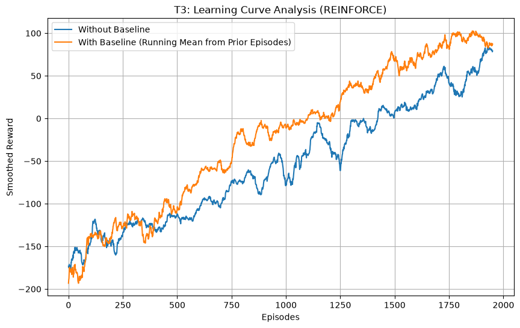
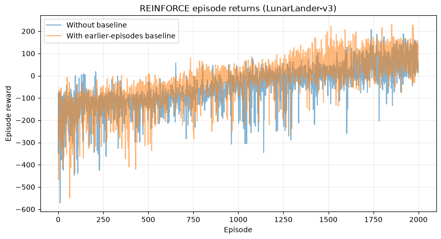
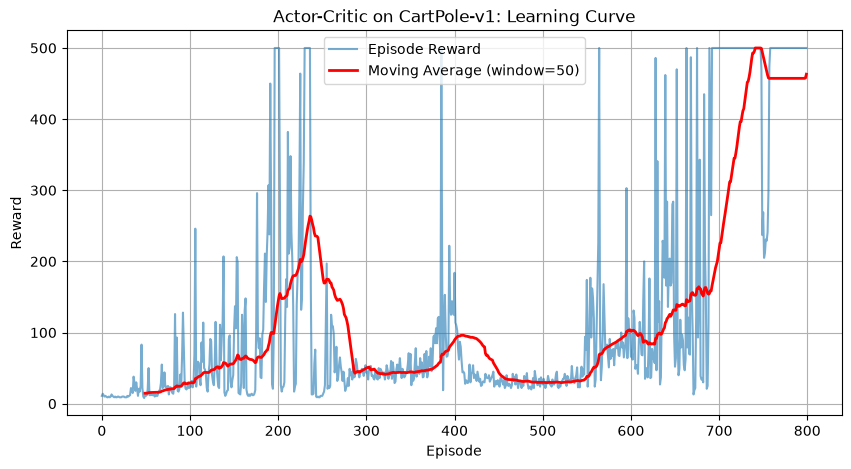
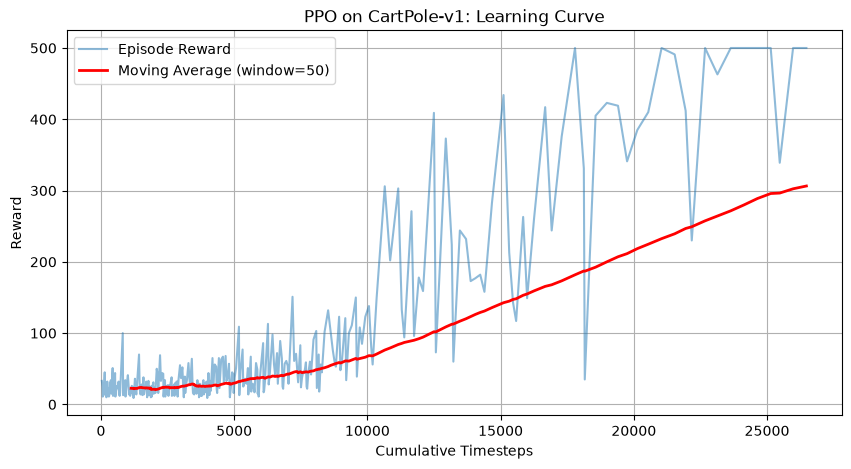
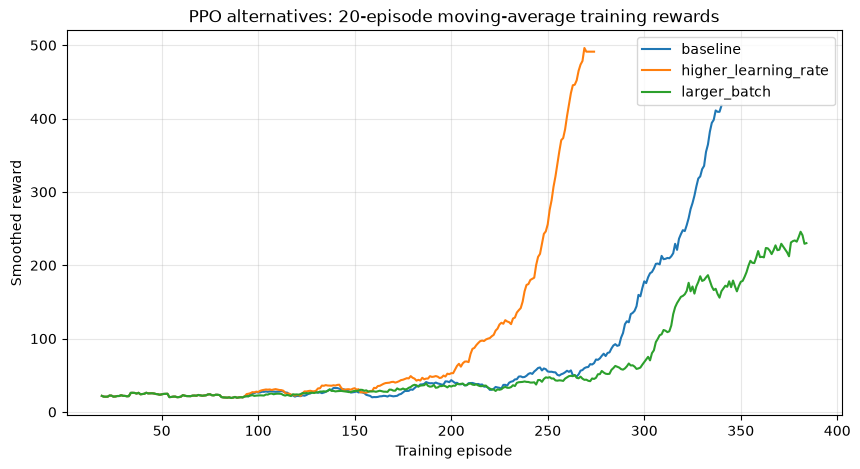

# گزارش فارسی تکلیف دوم — روش‌های گرادیان سیاست

**درس:** یادگیری آماری پیشرفته و مدل‌سازی — ماژول A  
**دانشجو:** امید شجاعیان  
**مبنای گزارش:** سه نوت‌بوک اجراشده تکلیف دوم، ۱۲ اکتبر ۲۰۲۶.  
**صورت‌سؤال رسمی:** تکلیف دوم استاد، نوامبر ۲۰۲۵.

## خلاصه نتیجه‌ها

این تکلیف سه رویکرد را بررسی می‌کند: رینفورس، بازیگر ـ منتقد و روش بهینه‌سازی سیاست مجاور.

| روش | نتیجه ثبت‌شده |
|---|---|
| رینفورس، بدون خط پایه | میانگین پاداش ۱۰۰ اپیزود آخر: **{{reinforce_no}}** |
| رینفورس، با خط پایه | میانگین پاداش ۱۰۰ اپیزود آخر: **{{reinforce_yes}}** |
| بازیگر ـ منتقد | میانگین ۱۰۰ اپیزود آخر: **{{ac_final}}** در اپیزود {{ac_episode}} |
| روش PPO پایه | میانگین پاداش ارزیابی: **{{ppo_base}}** |
| روش PPO با نرخ یادگیری بیشتر | میانگین پاداش ارزیابی: **{{ppo_lr}}** |
| روش PPO با دسته بزرگ‌تر | میانگین پاداش ارزیابی: **{{ppo_batch}}** |

توجه: نتایج رینفورس و بازیگر ـ منتقد مربوط به **مرحله آموزش** هستند؛ اما جدول ارزیابی PPO با اپیزودهای جداگانه محاسبه شده است.

## ۱. الگوریتم رینفورس

### روش و معماری

رینفورس یک روش گرادیان سیاست و از نوع **مونت‌کارلو** است. عامل ابتدا کل اپیزود را اجرا می‌کند، سپس از پاداش‌های مشاهده‌شده بازده تنزیل‌شده را می‌سازد و با آن احتمال اعمال مناسب را تغییر می‌دهد.

شبکه سیاست دارای **۸ ورودی، یک لایه ۱۲۸تایی و ۴ خروجی احتمال عمل** است. هر دو نوع آموزش ۲٬۰۰۰ اپیزود، حداکثر هزار قدم، نرخ یادگیری ۰٫۰۰۱ و ضریب تنزیل ۰٫۹۹ دارند. به‌روزرسانی پارامترها پس از پایان هر اپیزود انجام می‌شود.

**تفاوت نسخه محیط:** در صورت‌سؤال نسخه دوم فرود ماه‌نشین آمده است؛ اما کتابخانه جدید آن را منسوخ کرده و اجرای نهایی از **نسخه سوم** استفاده کرده است. بنابراین اعداد گزارش مربوط به نسخه سوم هستند.

### چرا خط پایه مفید است؟

بازده اپیزودهای مختلف ممکن است بسیار متفاوت باشد؛ بنابراین گرادیان تخمینی نوسان زیادی دارد. خط پایه عددی است که از بازده کم می‌شود تا تغییرات به نسبت یک مقدار مرجع سنجیده شوند.

\`gradient ≈ Σ grad(log π(a|s)) × (return − baseline)\`

در کد فعلی، خط پایه میانگین متحرکی است که فقط از **اپیزودهای قبلی** ساخته می‌شود. این روش با نرمال‌سازی بازده در همان اپیزود تفاوت دارد و منتقدِ یادگیرنده نیست.

| معیار | بدون خط پایه | با خط پایه |
|---|---:|---:|
| میانگین پاداش ۱۰۰ اپیزود نهایی | {{reinforce_no}} | {{reinforce_yes}} |

در این اجرا، استفاده از خط پایه با **{{reinforce_diff}}** واحد میانگین پاداش بالاتر همراه بود؛ اما چون آزمایش چندبذری و آزمون معنی‌داری انجام نشده، نباید آن را اثبات قطعی برتری قلمداد کرد.

## ۲. بازیگر ـ منتقد

### دو بخش شبکه

بازیگر احتمال انجام هر عمل را تعیین می‌کند؛ منتقد تخمین می‌زند بودن در حالت فعلی چقدر ارزش دارد. شبکه یک بخش مشترک **۱۲۸ نورونی** دارد؛ سر بازیگر برای دو عمل احتمال می‌سازد و سر منتقد یک ارزش عددی برمی‌گرداند.

تفاوت کلیدی با رینفورس این است که در این پیاده‌سازی برای محاسبه خطای یادگیری منتظر پایان اپیزود نمی‌مانیم؛ در **هر قدم** از تخمین ارزش حالت بعدی کمک می‌گیریم.

### خطای اختلاف زمانی

\`TD target = reward + γ × V(next_state)\`

\`TD error = TD target − V(current_state)\`

اگر محیط واقعاً به پایان رسیده باشد، بخش ارزش حالت بعدی صفر می‌شود. بازیگر بر اساس علامت و اندازه همین خطا اصلاح می‌شود و منتقد تلاش می‌کند خطای پیش‌بینی خود را کاهش دهد.

پارامترهای اصلی این نسخه شامل نرخ یادگیری ۰٫۰۰۲، ضریب تنزیل ۰٫۹۹، حداکثر هزار اپیزود و سقف ۵۰۰ قدم در هر اپیزود است.

در اپیزود **{{ac_episode}}**، میانگین پاداش صد اپیزود قبلی **{{ac_final}}** شد و شرط توقف آموزش را گذراند. این عدد **ارزیابی جداگانه روی اپیزودهای آزمایشی جدید نیست**؛ فقط نشان‌دهنده عملکرد خوب در پایان آموزش ثبت‌شده است.

## ۳. الگوریتم PPO

### ایده اصلی

روش PPO تلاش می‌کند هنگام اصلاح سیاست، آن را یک‌باره بیش از اندازه تغییر ندهد. از نسبت احتمال عمل در سیاست جدید به سیاست قبلی استفاده می‌کند و با عملیات برش، سود ظاهری تغییرات خیلی بزرگ را محدود می‌سازد.

\`ratio = π_new(action|state) / π_old(action|state)\`

این الگوریتم **درون‌سیاستی** است و داده‌های آموزش باید از اجرای سیاست فعلی جمع‌آوری شوند. اضافه کردن پاداش آنتروپی می‌تواند تنوع اعمال و اکتشاف را تقویت کند؛ در این پروژه پیاده‌سازی آماده کتابخانه استفاده شده است.

### معماری و پارامترها

شبکه پایه از دو لایه پنهان ۶۴تایی استفاده می‌کند. نرخ یادگیری آن ۰٫۰۰۰۳، ضریب تنزیل ۰٫۹۹، تعداد قدم هر چرخه جمع‌آوری ۲٬۰۴۸ و اندازه دسته ۶۴ است. تعداد قدم درخواست‌شده ۲۵٬۰۰۰ بوده؛ به علت کامل شدن آخرین چرخه جمع‌آوری، لاگ اجرای پایه تا **۲۶٬۶۲۴** قدم ادامه یافته است.

### مقایسه دو تنظیم جایگزین

برخلاف توضیحات فرضی، استاد می‌خواست حداقل دو پیکربندی واقعاً آزمایش شوند. این کار انجام شد و هر سه نسخه روی ۳۰ اپیزود ارزیابی شدند.

| پیکربندی | نرخ یادگیری | دسته | میانگین پاداش | انحراف معیار |
|---|---:|---:|---:|---:|
| پایه | ۰٫۰۰۰۳ | ۶۴ | {{ppo_base}} | {{ppo_base_sd}} |
| نرخ یادگیری بیشتر | ۰٫۰۰۱ | ۶۴ | {{ppo_lr}} | {{ppo_lr_sd}} |
| دسته بزرگ‌تر | ۰٫۰۰۰۳ | ۱۲۸ | {{ppo_batch}} | {{ppo_batch_sd}} |

دو مدل اول در این ۳۰ ارزیابی به پاداش کامل **۵۰۰** رسیدند. مدل با دسته بزرگ‌تر میانگین پایین‌تری داشت. این نتیجه مربوط به **یک اجرای مشخص** است و اثبات نمی‌کند که دسته بزرگ‌تر همیشه بدتر است.

## جمع‌بندی برای امتحان

- رینفورس: گرادیان سیاست با بازده کامل اپیزود؛ نوسان زیاد، امکان استفاده از خط پایه.
- بازیگر ـ منتقد: یک سیاست و یک تخمین‌زن ارزش؛ در این نسخه به‌روزرسانی در هر قدم و استفاده از خطای یک‌مرحله‌ای.
- PPO: جلوگیری از تغییر بیش‌ازحد سیاست با نسبت احتمال و برش؛ استفاده از داده‌های جمع‌آوری‌شده توسط سیاست فعلی.

نتایج آموزش را با نتایج ارزیابی مستقل اشتباه نگیر. از این گزارش برای فهمیدن و مرور استفاده کن؛ مدرک اصلی تحویل استاد **نوت‌بوک‌های دارای کد، خروجی و نمودار** است.

## منابع

صورت‌سؤال رسمی تکلیف دوم استاد (نوامبر ۲۰۲۵) و سه نوت‌بوک اجراشده پوشه \`moduleA/Assignment2\` در گیت‌هاب. تمامی شکل‌ها از خروجی واقعی و ذخیره‌شده نوت‌بوک‌ها استخراج شده‌اند.
